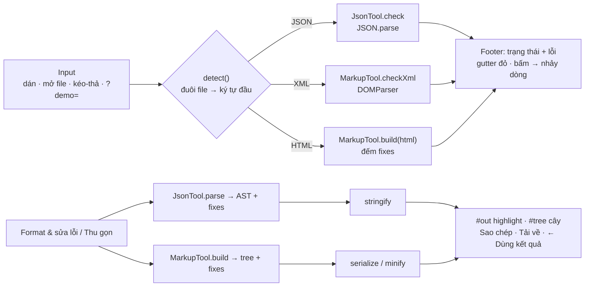

# Diagrams — web_tool

Lưu **cả file gốc** (mermaid / draw.io) **lẫn ảnh export** để AI đọc được. Ưu tiên mermaid.

## Luồng xử lý tab Format của `data-workbench.html` (trước là `format-json-xml-html.html`)

